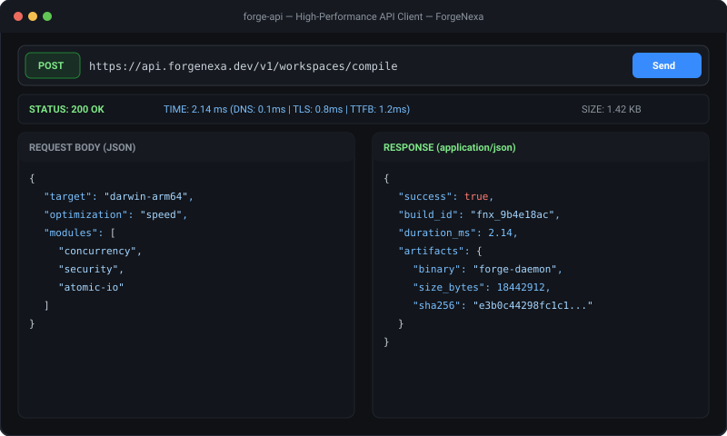

# Forge API — High-Throughput API Development & Testing Client

[](https://forgenexa.github.io/)

[](LICENSE)
[](https://golang.org)
[](https://react.dev/)
[](https://www.typescriptlang.org/)
[](https://vitejs.dev/)
[](https://github.com/ForgeNexa/forge-api/actions/workflows/ci.yml)

> **"Sub-millisecond API diagnostics powered by Go."**  
> An open-source, local-first API client engineered for software engineers, backend architects, and QA engineers who demand lightning speed and zero cloud data harvesting.

---

## 🏷️ Tags & Hashtags

`#ForgeNexa` `#ForgeAPI` `#APIClient` `#DeveloperTools` `#DevTools` `#GoLang` `#React19` `#TypeScript` `#OpenSource` `#LocalFirst` `#REST` `#Testing`

---

## ✨ Features

- **Concurrent Go Execution Engine**: Built with native Go connection pooling and keep-alives (`engine/pkg/executor`).
- **Sub-Millisecond Telemetry**: DNS lookup, TCP connect, TLS handshake, and Time-To-First-Byte (TTFB) measurements.
- **Local-First & Encrypted**: Secrets and tokens encrypted with AES-256-GCM. Never uploads request data to external cloud servers.
- **Code Snippet Exporter**: Generate production-ready cURL, Go, Python, and JavaScript code snippets with a single click.

---

## 🛠️ Build & Development

```bash
# Test the Go HTTP Engine
cd engine
go test -v -race ./...

# Build the React 19 Workbench
cd ../web
bun install --frozen-lockfile
bun run build
```

---

## 🌐 Part of ForgeNexa

Forge API is a standalone component of the [ForgeNexa Developer Tools Ecosystem](https://forgenexa.github.io/).

- [Forge IDE](https://github.com/ForgeNexa/forge-ide) — Code editor with Monaco and Go daemon
- [Forge Terminal](https://github.com/ForgeNexa/forge-terminal) — Multiplexed terminal emulator
- [Forge Git](https://github.com/ForgeNexa/forge-git) — Visual commit graph DAG and diff viewer
- [Forge Hub](https://github.com/ForgeNexa/forge-hub) — Unified ecosystem launcher
- [Forge Core](https://github.com/ForgeNexa/forge-core) — Shared Go systems foundation

---

## 📄 License

MIT © [ForgeNexa](https://forgenexa.github.io)
